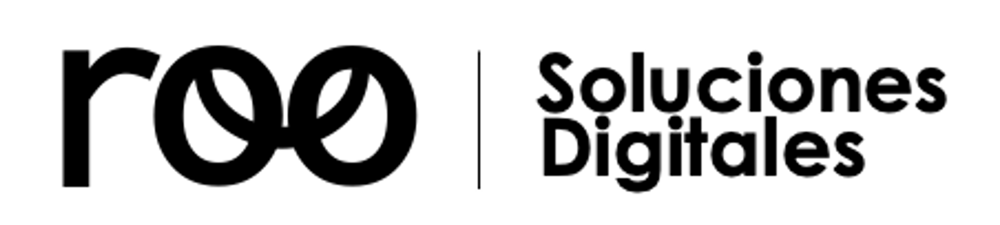
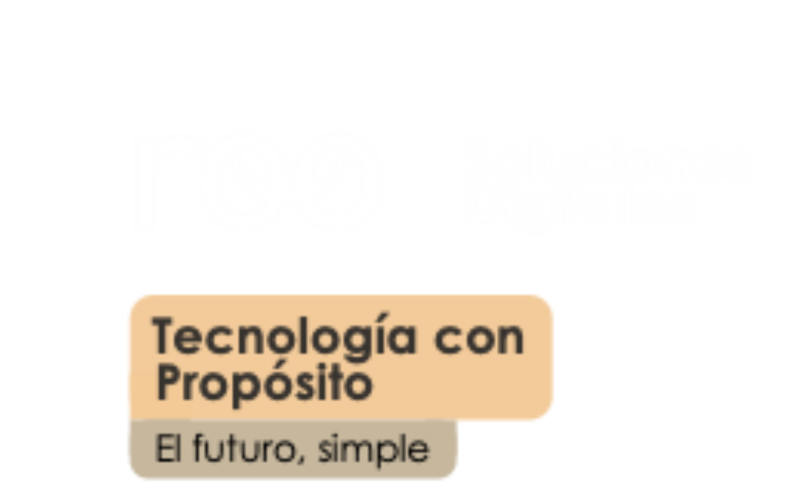

<div align="center">



# Portal Arquitectura XR
### Servidor Local, Hub de Modelos 3D y Radar de Distribución para Meta Quest & WebXR

[](https://python.org)
[](https://github.com)
[](https://www.khronos.org/gltf/)
[](https://pywebview.flowrl.com/)
[](#ecosistema-arquitectura-mr--xr)

<br/>



<p><em>"Tecnología con Propósito — El futuro, simple"</em></p>

---

### **Desarrollado por:**
**Diego Joel Cuba Moya** & **Ronaldo Carlos Robles Romero**  
**Empresa:** **roo | Soluciones Digitales**

</div>

---

## 🏛️ Ecosistema Arquitectura MR / XR

Este proyecto forma parte de la suite espacial de **roo | Soluciones Digitales**, compuesta por dos sistemas complementarios diseñados para trabajar en sincronía sin cables:

```
┌────────────────────────────────────────┐       Wi-Fi Local (5 GHz)        ┌────────────────────────────────────────┐
│     PORTAL ARQUITECTURA XR (PC)        │  ◄════════════════════════════►  │       VISOR ARQUITECTURA MR (VR)       │
│                                        │   UDP Radar Broadcast (47777)    │                                        │
│ • Servidor HTTP multihilo (RFC 7233)   │   HTTP Range Streaming (8000)    │ • Cliente inmersivo Meta Quest (Unity) │
│ • Sincronización y emparejamiento PIN  │                                  │ • Pipeline Universal URP PBR 90 FPS    │
│ • Optimizador de mallas (gltfpack)     │                                  │ • Modos: Peatón 1:1, Dron, Maqueta AR  │
│ • Panel Web y Desktop (pywebview)      │                                  │ • Interfaz curva World-Space VisionOS  │
└────────────────────────────────────────┘                                  └────────────────────────────────────────┘
```

1. **[Portal Arquitectura XR](https://github.com/DahGhoul/PortalArquitecturaXR) (Este repositorio / PC):**  
   Aplicación de escritorio y servidor local para la laptop o estación de trabajo del arquitecto. Gestiona la carga de archivos `.glb`, optimiza mallas con `gltfpack`, emite la señal de radar UDP y transmite los modelos de forma ultrarrápida.
2. **[Visor Arquitectura MR](https://github.com/DahGhoul/VisorArquitecturaMR) (Unity / Meta Quest):**  
   Aplicación inmersiva para visores Meta Quest (2, 3, 3S, Pro) y PC VR. Detecta automáticamente la PC en la red, descarga el modelo y permite recorrerlo a escala 1:1, sobrevolarlo como dron o manipularlo como maqueta en la mesa mediante Passthrough.

---

## 🌟 Características Principales

### 1. Descubrimiento Automático por Radar UDP
- Emite balizas UDP broadcast continuas en el puerto `47777`.
- El visor Meta Quest detecta de inmediato el servidor sin necesidad de escribir direcciones IP manuales.
- Incluye vinculación de respaldo por **código PIN de 4 dígitos** para redes corporativas con aislamiento de broadcast.

### 2. Transmisión HTTP Eficiente con Range Requests (RFC 7233)
- Soporte nativo para peticiones parciales por rangos de bytes (`HTTP 206 Partial Content`).
- Descarga fluida de proyectos pesados (+100 MB a +1 GB) sin bloquear la memoria RAM ni saturar la conexión inalámbrica.

### 3. Pipeline de Optimización VR Integrado (`gltfpack`)
- **Recorrido de Lujo VR (Recomendado):** Fusión de primitivas geométricas por material (`-mm`), reduciendo de miles a menos de 100 las llamadas de dibujado (*draw calls*) y preservando el **100% de la geometría intacta**.
- **Equilibrado VR:** Fusión de mallas con reducción conservadora del 15% de triángulos y protección estricta de bordes (`-slb`) para escalones y cornisas.
- **Ultra Ligero VR:** Reducción del 50% para proyectos con densidades masivas (+2M polígonos).
- **Sin optimizar:** Almacenamiento directo del archivo de trabajo original sin transformaciones.

### 4. Interfaz Moderna y App de Escritorio Nativa
- Ejecución de escritorio ultraligera mediante `pywebview` (utilizando Microsoft Edge WebView2 en Windows o WebKit en macOS), evitando el excesivo consumo de memoria de Electron.
- Visor 3D WebGL integrado bajo demanda (`<model-viewer>`) con liberación automática de GPU al salir del modo de inspección.

---

## 📐 Guía de Buenas Prácticas de Modelado 3D y Exportación a .GLB

> [!NOTE]
> **Detección de Materiales 100% Universal (Sin depender de nombres de texto):**  
> El pipeline del visor **NO te obliga a renombrar materiales ni depende de palabras clave**. El motor examina directamente los bytes del archivo glTF 2.0 en tiempo de ejecución:
> - Si un material tiene **opacidad menor al 99%**, se convierte automáticamente en **Vidrio URP Transparente**.
> - Si la textura tiene **canal alfa transparente real (PNG/RGBA)**, se procesa automáticamente como **Vegetación Alpha Cutout** con color natural fotográfico puro.
> - Si es una superficie sólida, respeta la especificación glTF 2.0 (doble cara o una cara según corresponda).
>
> **¿Por qué existe esta guía entonces?**  
> Porque existen errores puramente **geométricos y de formato en SketchUp** que ningún motor del mundo puede adivinar por arte de magia (como dos caras ocupando exactamente el mismo espacio milimétrico, caras modeladas de espaldas o imágenes sueltas sin geometría). Sigue estas pautas de modelado para garantizar un modelo impecable:

### 1. Cuadros, Planos y Láminas: Pintar como "Textura" y NUNCA pegar como "Imagen Suelta"
- **El error común:** En SketchUp es común ir a `Archivo > Importar > como Imagen` y pegar una foto o plano flotando sobre una pared. Al exportar a glTF/GLB, SketchUp NO integra la imagen a la pared: genera una lámina separada flotante sin mapeado UV en la estructura, provocando que se desplace, flote en el aire o parpadee.
- **La solución correcta:** 
  1. Crea un **Material nuevo**, cárgale la foto como textura y **píntala directamente con el bote de pintura sobre la cara del muro**.
  2. Si es un cuadro decorativo con relieve: modela un marco con volumen 3D ($1\text{ a }2\text{ cm}$ de espesor) o separa la lámina al menos **$2\text{ mm}$ hacia afuera de la pared** para que dos superficies de distinto material no compitan por la misma coordenada exacta (*Z-Fighting* coplanar).

### 2. Muros Estructurales: Geometría Sólida con Espesor (Push/Pull)
- **El error común:** Usar un plano 2D de grosor $0$ o una imagen plana para simular una pared o tabique.
- **La solución correcta:** Los motores de colisión física en VR (`CharacterController` y `PhysX`) necesitan volumen espacial para frenar al jugador de rodilla a cabeza de manera sólida. **Todo muro debe tener espesor real modelado con Empujar/Tirar (Push/Pull)** de al menos $10\text{ a }15\text{ cm}$.

### 3. Suelos Invisibles y Caídas al Vacío: Caras Invertidas y Losas con Espesor
- **El error común:** Modelar una losa, piso o vereda como una simple cara 2D de una sola cara (espesor cero) y dejar el lado azul/gris (reverso) hacia arriba. En motores 3D y VR, el reverso de una cara plana de grosor cero se descarta por optimización (*Backface Culling*), volviéndose **100% invisible y dejando ver el vacío o fondo gris**.
- **La solución correcta:**
  1. **Espesor real:** Toda losa, piso o pavimento debe tener volumen tridimensional con *Empujar/Tirar* (mínimo $15\text{ a }20\text{ cm}$ hacia abajo).
  2. **Orientación de normales:** En SketchUp, las caras superiores por donde camina el usuario deben ser **blancas**. Si ves alguna cara en tono azulado o grisáceo: Clic derecho > **Invertir Caras** (*Reverse Faces*).

### 4. Vegetación, Follaje y Enredaderas: PNGs con Transparencia Real y Sin Tintes
- **El error común:**
  - Usar imágenes JPG o imágenes con fondos falsos de cuadritos de Photoshop: generan **cuadros blancos sólidos** alrededor de las hojas.
  - Aplicar tintes de color sobre la textura en el editor de SketchUp: esto "destiñe" o apaga el verde fotográfico de la textura dejándola plomiza o grisácea en VR.
- **La solución correcta:**
  1. Usar siempre archivos **PNG con canal alfa transparente genuino**.
  2. Mantener el material en color blanco base (`#FFFFFF`) para que el visor proyecte el color fotográfico natural de las hojas sin alteraciones.

### 5. Vidrios y Ventanas: Opacidad Nativa en SketchUp
- **La solución:** Simplemente asígnale un porcentaje de transparencia/opacidad a tu material en SketchUp (por ejemplo $30\%$ a $50\%$). El visor detecta automáticamente la opacidad del archivo glTF y le aplica el shader URP de vidrio transparente con brillo fotométrico, **sin importar cómo le hayas puesto de nombre al material**.

### 6. Limpieza y Purga del Archivo (Antes de Exportar a .GLB)
1. **Purgar no usados:** En SketchUp ve a `Ventana > Información del modelo > Estadísticas > Purgar no usados`. Esto elimina gigabytes de materiales huérfanos, bloques invisibles y geometrías residuales.
2. **Modelar cerca del Origen (0,0,0):** Asegúrate de que el proyecto esté ubicado cerca del eje de coordenadas inicial. Modelar a cientos de metros del origen causa temblores de cámara (*jittering*) en visores VR por pérdida de precisión numérica.
3. **Formato:** Exportar siempre como **`.glb` binario (glTF 2.0)** con unidades en **metros**. Presupuesto sugerido: menor a $2\text{M}$ de polígonos para Meta Quest autónomo (o usar la optimización con `gltfpack` desde este portal).

---

## 📋 Requisitos del Sistema

### Para Portal Arquitectura XR (Estación PC):
- **Sistema Operativo:** Windows 10/11 (64-bit) o macOS 12+ (Apple Silicon o Intel).
- **Entorno:** Python 3.10 o superior (si se corre desde código fuente) o el ejecutable portable empaquetado `.exe` / `.app`.
- **Puertos de Red:** `8000` TCP (Servidor HTTP) y `47777` UDP (Radar broadcast).
- **Conectividad:** Conexión a la misma red Wi-Fi que el visor Meta Quest (se recomienda router Wi-Fi 5 GHz o 6 GHz).

### Para Visor Arquitectura MR (Visor VR):
- **Dispositivo:** Meta Quest 2, Meta Quest 3, Meta Quest 3S o Meta Quest Pro.
- **Instalación:** Paquete `.apk` instalado mediante SideQuest o Meta Quest Developer Hub.

---

## 💻 Instalación y Ejecución

### Opción A: Ejecución desde Código Fuente (Python)

1. **Clonar el repositorio:**
   ```bash
   git clone https://github.com/DahGhoul/PortalArquitecturaXR.git
   cd PortalArquitecturaXR
   ```

2. **Crear entorno virtual e instalar dependencias:**
   ```bash
   python -m venv .venv
   # En Windows:
   .venv\Scripts\activate
   # En macOS/Linux:
   source .venv/bin/activate

   pip install -r requirements.txt
   ```

3. **Ejecutar la aplicación:**
   ```bash
   python portal_arquitecto.py
   ```

   > **Modo Navegador:** Si prefieres abrirlo en tu navegador habitual sin ventana nativa pywebview:
   > ```bash
   > python portal_arquitecto.py --navegador
   > ```

### Opción B: Compilación a Ejecutable Nativo

- **En Windows (`.exe`):**
  Ejecuta `build_windows.bat`. El ejecutable quedará generado en `dist\PortalArquitecturaXR\PortalArquitecturaXR.exe`.
- **En macOS (`.app` y `.dmg`):**
  Ejecuta `./build_mac.sh`. Se generará el paquete en `dist/PortalArquitecturaXR.app`.

---

## 📦 Estructura del Repositorio

```
portal-arquitectura-xr/
├── portal_arquitecto.py        # Núcleo del servidor, radar UDP y motor de optimización
├── PortalArquitecto.spec       # Receta de empaquetado PyInstaller para Windows y macOS
├── build_windows.bat           # Script de compilación desatendida para Windows
├── build_mac.sh                # Script de compilación, firma y creación de .dmg para macOS
├── requirements.txt            # Dependencias del proyecto (pywebview, pyinstaller)
├── .gitignore                  # Reglas de exclusión de Git (builds, temporales y modelos pesados)
├── .github/
│   └── workflows/
│       └── build.yml           # Integración continua para generar instaladores en GitHub Actions
├── static/                     # Frontend web responsive de la aplicación
│   ├── img/                    # Identidad gráfica institucional (roo Soluciones Digitales)
│   │   ├── roo-logo.png        # Logotipo horizontal institucional
│   │   └── roo-badge.png       # Insignia corporativa
│   ├── index.html              # Panel de control del portal
│   ├── styles.css              # Sistema de diseño dark
│   ├── app.js                  # Lógica de interacción y carga asíncrona
│   └── vendor/
│       └── model-viewer.min.js # Motor de previsualización 3D WebGL
├── modelos_vr/                 # Carpeta de trabajo para modelos .glb cargados
└── herramientas_vr/            # Binarios auxiliares portables (gltfpack)
```

---

## 📄 Licencia y Créditos

Este software ha sido diseñado y desarrollado como propiedad intelectual de:

**roo | Soluciones Digitales**  
*Lema:* **"Tecnología con Propósito — El futuro, simple"**

**Desarrolladores Principales:**
- **Diego Joel Cuba Moya**
- **Ronaldo Carlos Robles Romero**

*Copyright © 2026 roo Soluciones Digitales. Todos los derechos reservados.*
